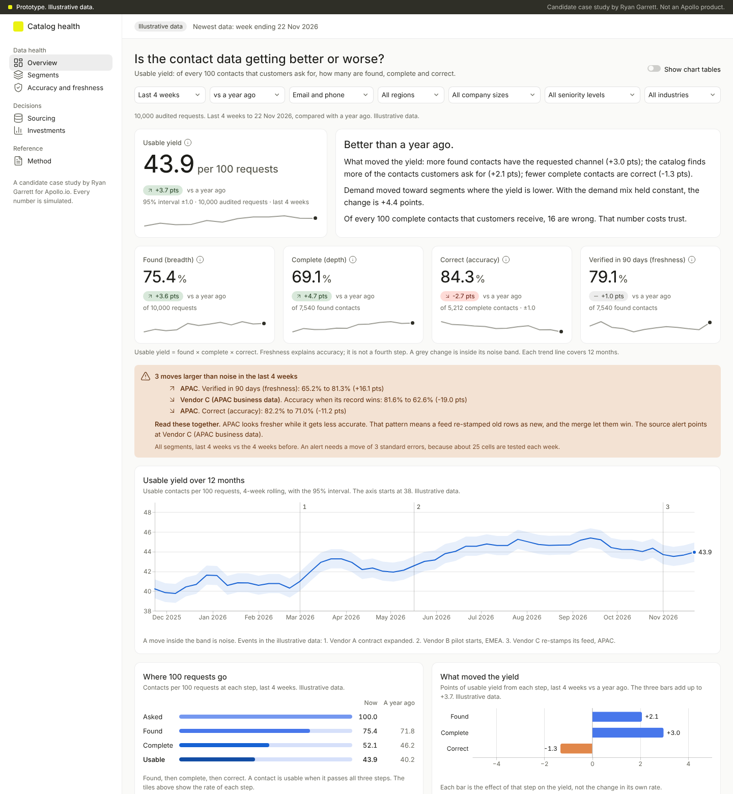

# Catalog health: usable yield

A mock telemetry dashboard for a B2B contact catalog. It answers one question for data leadership: **is the contact data getting better or worse?**

**All data is simulated.** A seeded model builds every row. Nothing here is Apollo data, and this is not an Apollo product. It is a candidate case study by Ryan Garrett for Apollo.io.



## The point of view

- A catalog average hides the truth, so the dashboard measures what customers get.
- **One headline: usable yield.** Of every 100 contacts customers ask for, how many are found, complete, and correct?
- **Each pillar is one step.** Breadth = found. Depth = complete. Accuracy = correct. Freshness explains why accuracy falls.
- **One guardrail beside the headline: wrong contacts delivered per 100 requests.** The yield cannot fall when a field is filled with a wrong value. A higher yield with more wrong contacts reads as "Mixed", not "Better".
- **Accuracy is the hardest pillar to measure honestly.** Bounce and connect signals only cover records that customers chose to use. The dashboard uses a blind audit sample and shows the interval.
- **One number drives sourcing: cost per net-new usable contact.** Take the source out, run the merge again, and count what customers lose. It holds for one removal at a time, so the scorecard also shows the cost with the nearest overlap removed, and a 95% range.

## What each page answers

| Page | Question |
|---|---|
| Overview | Better or worse? What moved it? What needs attention this week? |
| Segments | Where is the yield low, which source is the cause, and where is the unmet demand? |
| Accuracy and freshness | Can you trust the accuracy number? What does the audit cost? |
| Sourcing | Which sources earn their cost? Who depends on whom? |
| Investments | Where does the next dollar go? What was left out? |
| Method | How is each number defined, and where should you not trust it? |

## Run it

```bash
python -m venv .venv && source .venv/bin/activate
pip install -r requirements-dev.txt
streamlit run app.py
pytest -q          # see the count by kind under 'Check the numbers yourself'
```

Tested with Python 3.13. The pinned packages need Python 3.12 or later.

## Put it on Streamlit Community Cloud

1. Push this folder to a GitHub repository.
2. Go to [share.streamlit.io](https://share.streamlit.io) and select **Create app**.
3. Select **Yup, I have an app**.
4. Enter the repository, the branch, and the file path `app.py`.
5. Optional: choose a subdomain in the **App URL** field.
6. Open **Advanced settings**, set the Python version to 3.13, and save. Then deploy.

A Community Cloud app goes to sleep when it has no visitors for about 12 hours. A visitor then sees a wake-up button and waits about a minute. Open the app before you share the link.

## The design system

The look comes from the **Apollo Case Study Kit** in `design/`. The kit is unofficial. It was made for this case study: its tokens record what the public pages of Apollo.io show, and its components are original. Read `design/KIT_README.md` for its rules and `design/KIT_SOURCES.md` for where each value comes from.

The app follows the kit's rules for a prototype:

- Every screen starts with the prototype banner. A test fails if it is not the first element.
- The name "Apollo.io" appears in plain type. There is no logo. The brand row shows a product name and a plain square.
- Every chart states its measure, its period, and "Illustrative data". Every chart has a table view (the **Show chart tables** switch).
- Colour, type, spacing and radius come from tokens. A test fails if a Python file or `streamlit.css` types a colour by hand.

How the kit meets Streamlit:

| File | What it does |
|---|---|
| `design/tokens.json`, `design/bundle.css`, `design/icons.json` | The kit, unchanged. |
| `design/tokens.css` | The tokens as CSS variables. Generated: `python design/build_tokens.py`. |
| `design/streamlit.css` | Maps Streamlit's own page structure and widgets to the tokens. |
| `kit.py` | The kit's components as HTML (tiles, tables, heat grids, meters, alerts), and `kit.color()` for the charts. |
| `.streamlit/config.toml` | Streamlit's theme, with values copied from the tokens. A test compares them. |

Three things that Streamlit does differently, and what the app does about each:

1. `st.html` removes inline SVG. So icons are CSS masks, each sparkline is a small SVG image, and the data flow diagram is an SVG image that carries its font.
2. Vega-Lite takes font weights in hundreds only. The charts ask for 500 and 600, and `streamlit.css` maps them to the kit's 450 and 550.
3. Streamlit gives a widget a new state on each page. `ui.sticky()` keeps a filter's value when the reader changes page.

Fonts: Inter and Roboto Mono (SIL Open Font License) are in `static/`. Icons: Lucide (ISC License). The licence texts are in `design/LICENSES.txt`.

## Files

| File | What it holds |
|---|---|
| `app.py` | The frame: banner, sidebar, top bar, navigation. |
| `views/` | One file for each page. Layout and text only. |
| `ui.py` | What every page shares: the data, the filter bar, the chart frame. |
| `metrics.py` | Every metric, defined once. The Method page prints its text from here. |
| `charts.py` | The Altair charts, drawn with the kit's chart tokens. |
| `kit.py`, `design/`, `static/` | The design system, and how it is applied. |
| `mockdata.py` | The simulation. |
| `tests/` | `test_metrics.py` recomputes the numbers by a second route. `test_app.py` runs every page. `test_design.py` keeps the app on the kit. |

## The model in six sentences

1. Each row is one sampled customer request for a contact: an email reveal or a phone reveal (2,500 rows a week, 65 weeks).
2. Every person has a hidden clock: months since the last job change.
3. Each source either has the person or not, and last observed them some months ago. A source is right about the employer only if it observed the person after the last job change.
4. The catalog merges sources. The most recently stamped record wins employer and title. Email and phone come from the best available source.
5. The audit knows the truth, so every row carries the real outcome.
6. Leave-one-out: the merge runs again without each source. That shows what the source adds and what it breaks.

Three events are built in: Vendor A's contract expands, Vendor B's pilot starts in EMEA, and Vendor C's feed re-stamps old APAC rows 4 weeks ago. The last one is still open. It makes APAC look fresher while it gets less accurate.

**Fixed, not computed:** catalog row counts, the company table, and three guardrail values. The dashboard marks them where they appear.

## Check the numbers yourself

- The checks, by kind: the metric checks in `tests/test_metrics.py` (the ones that test the numbers), the page checks in `tests/test_app.py` (every page runs, every filter works), and the design checks in `tests/test_design.py`. Run `pytest --collect-only -q` for the current counts. The leave-one-out check uses the same merge code as the app, so it checks the bookkeeping, not the merge rule.
- `pytest -q` recounts the funnel row by row, checks that the yield equals the product of the three steps, and really removes each source and runs the model again to confirm the leave-one-out numbers.
- The Overview page has a download button for the audited rows behind the current view. Count `found`, `complete`, and `usable` in a spreadsheet; the counts must match the page.
- Same seed, same rows, same numbers.

## Extend it

- **Add a source:** add one `Source(...)` line to `SOURCES` in `mockdata.py`, and its key to `PHONE_PRIORITY`. The scorecard, the dependence grid, and the alerts pick it up.
- **Change a definition:** edit `metrics.py`. For example, `FRESH_MONTHS` sets what "fresh" means.
- **Add a segment value:** extend the list and its shares in `mockdata.py`. The filters read the lists.
- **Add a what-if:** add an entry to `SCENARIOS` in `ui.py`. Scenarios reuse the same random draws, so any difference comes from the change.
- **Add a page:** add a file to `views/` and one line to `PAGES` in `app.py`. Start it with `ui.page_head(...)`.
- **Change the look:** edit `design/streamlit.css`, or replace the kit's files and run `python design/build_tokens.py`. An edit to a file in `design/` shows on the next run.
